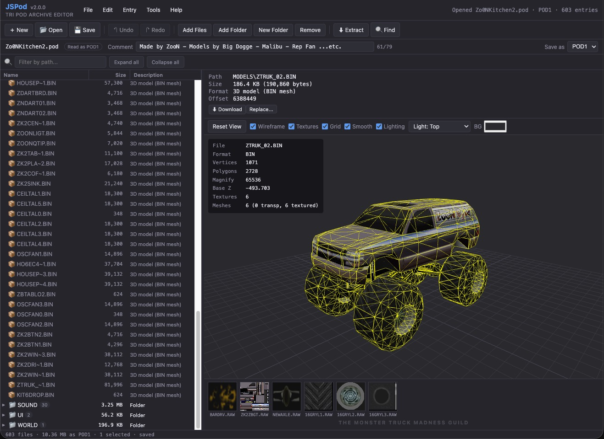

# JSPod

[](https://developer.mozilla.org/docs/Web/JavaScript)
[](https://threejs.org/)
[](https://developer.mozilla.org/docs/Web)
[](https://juanputrerasm.github.io/JSPod/)
[](LICENSE)

**A browser-based editor for Terminal Reality POD archives.**

JSPod creates, edits and saves POD1 and POD2 archives, and opens EPD and ZIP archives, without uploading anything to a server. It has the feature set of the desktop tool KPod (add, replace, rename, move, remove, disable in game, extract, validate, POD2 audit history, response lists, reports, pod.ini mounting), plus undo/redo, a text-entry editor and image import, and it previews the game assets inside.

**Live application:** [Open JSPod on GitHub Pages](https://juanputrerasm.github.io/JSPod/)



---

## What's new in 2.1.2

- Track format version 6 (https://openmtm2.github.io/proposals/track-format-v6): `.SI3` tracks previewed as text, and disabled for the game as `.SIZ` and back.
- The `.WTR` lake map, `.VEG` vegetation map and `.WFL` crest map draw a 512-cell world (16,384 ft) when the file holds one.
- A newer build of OpenPhotex 1.7.3.

## What's new in 2.1.1

- Community Patch 4 beta 0.53 waterfalls (.WFL): a table of the falls and a top-down map of their crest lines.
- The .WTR, .VEG and .WFL readers are now OpenPhotex's (vendored 1.7.3), not JSPod's own.

## What's new in 2.1

- OGG Vorbis and MP3 entries play in the preview.
- Community Patch 4 files: lake maps (.WTR) and MTM2 vegetation (.VEG) shown as tables and top-down maps, and 16-bit heightmaps (`DATA\*.RAW` of 128 KB or 2 MB) shown as greyscale height images.
- .CPT (3D cockpit layouts), .SRF (surface meshes) and .GST (Time Attack ghosts) recognised, with the _V, _G and _H images.

## What's new in 2.0

JSPod is now an archive editor, not only a viewer. It covers everything the desktop tool KPod does, in the browser:

- Create archives, or edit existing ones: add files and folders, replace, rename, move, remove, and edit the comment.
- Save as POD1 or POD2 (with checksums and audit history), in place or under a new name.
- Undo and redo every change.
- Edit text entries directly, and import PNG, BMP, JPG or TGA art as game textures.
- Validate archives, build them from response lists, write `.inf`/`.lst` reports, and mount them in `pod.ini`.
- A new list with Name, Size and Description columns, sorting, multi-select, drag and drop, right-click menus and a Find panel.
- MOD music playback, opacity-plane previews, a full hex view, and Save as PNG for textures.

See [docs/PARITY.md](docs/PARITY.md) for the full comparison with KPod.

## Features

- **Archive authoring**: create a new archive, or open one and add files or whole folders, replace, rename, move, remove, create folders, and edit the comment. Every edit can be undone.
- **Save as POD1 or POD2**: POD2 output carries CRC checksums, timestamps and the audit trail. Save in place, Save As, or download.
- **Validation**: unsafe paths, duplicate names, name and comment limits, overlapping payloads and POD2 checksums.
- **KPod tools**: Disable/Enable in Game, response lists (`.lst`/`.rsp`), `.inf` and `.lst` reports, POD2 audit history, Mount in pod.ini.
- **Text editor and image import**: edit text entries in place; import PNG, BMP, JPG or TGA art as `.RAW` with its own `.ACT` or onto an existing palette.
- **Local or remote archives**: open files from disk, drag and drop, a URL, or an autoload query parameter.
- **Private client-side processing**: indexing, editing, decoding and saving happen in the browser.
- **Archive navigation**: a tree list with Name, Size and Description columns, sorting, a quick filter and a Find panel.
- **Asset previews**: inspect textures, palettes, 3D models, text, audio, and common web images.
- **CART Precision Racing models**: preview high-detail `.CMD` cars with their RAW/ACT textures and selectable road or speedway aero packages.
- **Nocturne models**: preview skeletal `.DFM` characters with their companion `.SKL`, and binary or text `.KFM` props and cloth meshes.
- **Modern MTM2 (Community Patch 3) support**: read long BIN texture names, material records, PNG/TGA textures, and tangent-space normal maps.
- **Extraction**: extract the selection or everything, with or without folders, into a folder or as a ZIP.

## Supported archive formats

| Format | Games | Support |
|---|---|---|
| POD1 | Monster Truck Madness 1 and 2, CART Precision Racing, Terminal Velocity, Fury3, Hellbender | Read and write |
| POD2 | 4x4 Evolution 1 and 2 | Read and write, with CRCs, timestamps and audit trail |
| EPD | Fly! | Read; save it as POD1 or POD2 |
| ZIP | Loads the first POD contained in the ZIP | Read |

Saving an archive that was opened unchanged reproduces it byte for byte: OpenPhotex rebuilds every stock POD1 directory and every stock 4x4 Evolution POD2 exactly.

POD1 has exactly one directory layout: 40-byte entries of `char name[32]`, `int32 size`, `int32 offset`, holding paths of up to 31 characters. A directory table that does not validate as 40-byte records is a malformed archive and is refused. See [POD1 format](docs/POD1_FORMAT.md).

## Preview support

| File types | Preview |
|---|---|
| `.BIN`, `.LWO` | Interactive Three.js model viewer with orbit controls. Compatible animated BIN frames blend smoothly; **Play** or the **A** key loops them |
| `.SMF` | 4x4 Evolution 1 and 2 models, in the same viewer |
| `.CMD` | CART Precision Racing high-detail vehicle models, with alternate aero-package selection |
| `.DFM`, `.KFM` | Nocturne skeletal characters and morph/prop models, with their RAW/ACT textures |
| `.RAW` | Paletted or grayscale texture with automatic dimension detection and ACT palette selection. A 16-bit `DATA\<track>.RAW` heightmap (131,072 or 2,097,152 bytes) is shown as greyscale with its height range in feet |
| `.ACT` | 256-color palette grid |
| `.TIF` | 4x4 Evolution 2 palette-indexed TIFF, drawn over a checkerboard when it carries an opacity sample |
| `.PNG`, `.TGA`, `.BMP`, `.JPG`, `.JPEG`, `.GIF`, `.WEBP` | Image preview |
| `.TXT`, `.INI`, `.TRK`, `.SIT`, `.SI2`, `.SI3`, `.SIX`, `.SIY`, `.SIZ`, `.TRX`, `.TXV`, `.LVL`, `.DEF`, `.VEG`, `.WAT`, `.CPT`, `.SRF`, and other text formats | Text preview |
| `.WTR`, `.VEG` with CP4 magic | Community Patch 4 lakes (`MWTR`) and vegetation (`MVEG`): tables plus a top-down tile map |
| `.WFL` | Community Patch 4 beta 0.53 waterfalls (`MWFL`): header, a table of the falls (source lake or spring, height, crest width, speed, opacity, mist, volume, flags, sound and texture) and the crest lines on the wrapping world square (8,192 ft, or 16,384 ft for a track format version 6 `.WFL` version 2 on a 512-cell world) |
| `.WAV`, `.OGG`, `.MP3` | Audio player (`.OGG` and `.MP3` play where the browser has the decoder) |
| `.MOD` | ProTracker music, rendered by OpenPhotex and played with seek and time |
| `.OPA` | Opacity plane, as greyscale |
| `.CLR` | Shown like `.RAW` |
| Anything else | Hex dump, paged 4 KB at a time, with a jump-to-offset box |

Text entries have an **Edit** button. Image previews (`.RAW`, `.CLR`, `.OPA`, `.TIF`, `.TGA`) have **Save as PNG**; `.RAW` also has **Save as BMP**.

CommPatch tracks and the disabled forms of tracks and trucks are described and
previewed alongside the originals: `.SI2` is a track only newer engines see, `.SI3`
is a track in track format version 6 (taller tracks and larger worlds,
https://openmtm2.github.io/proposals/track-format-v6), the same text as a `.SI2`, `.TXV`
is the plain-text record asserting what the pod around it contains, and `.SIX`,
`.SIY`, `.SIZ` and `.TRX` are `.SIT`, `.SI2`, `.SI3` and `.TRK` renamed to something the
game passes over. Art files name the map they are: a `_N`, `_AO`, `_DTL` or `_MASK` suffix on a
`.RAW`, `.PNG` or `.TGA` stem is reported as a normal map, ambient occlusion,
terrain detail normal or terrain detail mask.

Community Patch 4 (MTM2 beta 0.52 and 0.53) files are described too. `.OGG` and `.MP3` are its
music, `.CPT` the 3D cockpit layout and `.SRF` a model's surface material sidecar, both
text. A `.VEG` starting with `MVEG` is CP4's binary vegetation (species, trees, grass and
its RULE/INFO text), any other `.VEG` is 4x4 Evolution's text; `.WTR` (`MWTR`) holds the
lakes and the tile map of which lake covers each terrain tile. Beta 0.53 adds `.WFL`
(`MWFL`) waterfalls: up to 64 crest lines of 2 to 8 points, each fed by a lake from the
`.WTR` or by a spring at its own height, with flow speed, opacity, mist, sound and texture.
These three binary files are read with OpenPhotex (`parseWtr`, `parseMtm2Veg`, `parseWfl`).
`.GST` Time Attack ghosts are shown as hex. On a `.PNG`, `_V` and `_G` name the tree and grass vegetation masks and
`_H` the 16-bit grey height map. A `DATA\<track>.RAW` of 131,072 bytes (u16 256x256) or
2,097,152 bytes (u16 1024x1024 at an 8 ft grid) is a CP4 heightmap in 1/128 ft; CART
Precision Racing also ships 131,072-byte u16 RAWs in 1/16 ft, so that size offers both
units.

The BIN viewer understands classic and modern MTM2 records, including long texture names, material assignments, reflection and color blocks, and material parameters. For diffuse textures it resolves `.PNG`, then `.TGA`, then `.RAW`; `_N` normal maps use DirectX/green-down tangent space. Their RGB channels are decoded as X/Y/Z, alpha is ignored, and the engine has no roughness texture channel.

For early POD1 archives, JSPod also reads the hidden `.ACT` palette name stored after a `.RAW` path in the fixed-width directory field.

Palettes are ranked the same way in the RAW preview and the BIN texture fallback: the entry's own same-name `.ACT` and the name recorded in the directory field first, then the archive's own `METALCR2.ACT`, then its `VGA.ACT`, then the bundled palettes, greyscale, and every differently-named `.ACT` last. The archive's own METALCR2 outranks the bundled copy because METALCR2 is not one palette - CPR ships a different one from MTM1 and MTM2 - and a `VGA.ACT` in the pod means a flight game whose exact title cannot be told apart from here, so the pod's copy is the only safe pick. A differently-named `.ACT` is offered but never chosen automatically. The BIN selector supplies the fallback for textures that have no same-name `.ACT`, so same-name palettes belonging to other textures are listed there but never lead.

`.SMF` is 4x4 Evolution's static model format, a text `C3DModel` covering versions 2 to 4 including Evo 2's `v1` bump materials. It opens in the same viewer, and is detected by its magic rather than its extension so a renamed entry still opens. Evo is Y-up where `.BIN` is Z-up, and Evo's texture V runs top-down where `.BIN`'s does not, so the decoder converts both into the `.BIN` convention as it reads and the viewer then treats every model alike. That conversion negates Evo's Z on the way to the screen; leaving it out renders the model as its own mirror image, which reads as the texture being mirrored because a mirrored mesh still carries its own UVs. Diffuse textures resolve `.PNG`, `.TGA`, `.TIF`, then `.RAW`; an Evo `.RAW` also picks up its same-stem `.OPA` opacity plane, which is a real gradient rather than a mask and so is merged into the alpha channel instead of being reduced to the MTM colour key. Reduced-detail LOD groups are hidden when a model carries its full-detail pair.

`.CMD` is CART Precision Racing's text high-detail car model. JSPod positions its named parts, decodes fixed-point vertices, normals and UVs, and resolves the declared `.RAW` material with its same-stem `.ACT` palette. Stock cars carry road/street-course and speedway/oval wings in the same file, so the preview offers an aero-package selector and draws only one set at a time. See [CPR CMD format](docs/CPR_CMD_FORMAT.md).

Nocturne `.DFM` characters resolve the skeleton named by the model from the same archive, evaluate SKL frames through the parented quaternion hierarchy, skin the selected LOD, and resolve the DFM texture set. The preview toolbar selects the DFM LOD, motion, and motion frame, and can continuously loop the selected motion at its declared frame rate. `.KFM` props use the same viewer, support both binary v3–4 and text v5–8, and expose their morph frames with a slider.

Model textures use smooth filtering by default. The viewer preserves the current orbit, pan, and relative zoom while switching models or poses. Use the Left and Right Arrow keys to strafe the camera.

## Requirements

- A modern browser with JavaScript modules, Web Workers, WebGL, and Origin Private File System support
- An HTTP or HTTPS origin; browsers do not provide the required features when opened through `file://`
- Network access to the Three.js and fflate CDN modules

## Getting started

### Use the hosted application

1. Open [JSPod on GitHub Pages](https://juanputrerasm.github.io/JSPod/).
2. **File > Open** (or drop a POD, EPD or ZIP on the page), **File > Open from URL**, or **File > New Archive**.
3. Select entries in the list to preview them. Right-click for the entry commands, or use the **Entry** menu and the toolbar.
4. **File > Save** writes the archive back; **Save As** picks POD1 or POD2 and a new name.

> [!NOTE]
> Remote archives must be served over HTTP or HTTPS. Cross-origin servers must also allow the browser request through CORS.

### Run locally

Clone the repository and serve its root directory with any static HTTP server:

```bash
git clone https://github.com/juanputrerasm/JSPod.git
cd JSPod
python3 -m http.server 8080
```

Then open <http://localhost:8080/>. There is no build step and no package installation.

## Editing

All edits are made to a working copy; nothing reaches your file until you save.

| Command | What it does |
|---|---|
| Add Files, Add Folder | Adds files into the selected folder (or the root). A folder keeps its own name. A file's modification time becomes its POD2 timestamp. Existing names can be replaced or skipped. Dropping files or folders on the list does the same, onto the folder they are dropped on. |
| Create Folder | An empty folder, kept until it is filled or removed. POD archives store no empty folders, so one that is still empty is not saved. |
| Replace with File | Swaps an entry's data, keeping its name and palette record. |
| Rename, Move To Folder | A folder carries everything inside it. Dragging rows onto a folder moves them. |
| Remove | Removes the selection; a folder removes everything inside it. |
| Disable / Enable in Game | Renames `.TRK`/`.SIT`/`.SI2`/`.SI3` to `.TRX`/`.SIX`/`.SIY`/`.SIZ` and back, so the game passes over a track or truck without it being deleted. |
| Comment | The archive comment, at most 79 bytes. |
| Save as | POD1 or POD2 for the next save. POD1 names hold 31 bytes; POD2 names hold 255. |
| Undo, Redo | Every edit above, up to 200 steps, until the next save. |

An edit that would make the archive invalid (an unsafe path, a duplicate name, a name too long for the output format, text the archive's 8-bit encoding cannot store) is refused with the reason. An archive that arrives with problems can still be edited; Save asks for them to be fixed.

**POD2 audit history.** POD2 archives log each add, remove and change, with the author and time. JSPod keeps the existing trail and adds a record for every edit while **Tools > Record POD2 Audit History** is on. A rename or move is logged as a remove plus an add. Set the name recorded with **Tools > Set Audit Author**. POD1 has no audit history.

**Response lists.** **File > Open Response List** builds an archive from a `.lst` or `.rsp` recipe: pick the folder holding the list and its files. Each line is `file` or `file,ARCHIVE\NAME`; `podFilename:` and `volumeName:` set the file name and the comment; `//` starts a comment. Files are looked up next to the list, then one folder up.

**Reports.** **Tools > Save .inf Report** writes KPod's fixed-column report (name, size at column 30, offset at column 45). **Save .lst List** writes one entry name per line, which Open Response List reads back.

**Mount in pod.ini.** Adds the archive's name to the game's `pod.ini` (pick the folder that holds it). The same POD is never mounted twice, and JSPod warns at 99 mounted PODs.

## Browser support

Opening, editing, undo, validating, previews and saving work in current Chrome, Edge, Firefox and Safari. The File System Access API, available in Chromium browsers, adds:

| Feature | Chromium (Chrome, Edge) | Firefox, Safari |
|---|---|---|
| Save | Writes back to the file you opened | Downloads the archive |
| Save As | Save picker | Asks for a name, then downloads |
| Open Recent | The last 10 archives | Not available |
| Extract | Into a folder you pick | One entry downloads; several download as a ZIP |
| Mount in pod.ini | Yes | Not available |

## URL integration

JSPod can automatically load an archive supplied through either `url` or `file`:

```text
https://juanputrerasm.github.io/JSPod/?url=https%3A%2F%2Fexample.com%2Fgame.pod
https://juanputrerasm.github.io/JSPod/?file=%2Fdownloads%2Fgame.zip
```

Relative archive paths are resolved against the viewer page. When both parameters are present, `url` takes precedence.

## Architecture

| Component | Role |
|---|---|
| ES modules | Application, preview, and user-interface code |
| Module Web Worker | POD indexing, entry reads, archive writing, and asset decoding off the main thread |
| OPFS | Working storage: the open archive, added and edited data, and saved output |
| Three.js r169 | BIN/LWO, SMF, CMD, DFM, and KFM rendering and camera controls |
| fflate 0.8.2 | ZIP import and export |
| [OpenPhotex](https://github.com/juanputrerasm/OpenPhotex) 1.7.3 | POD1/POD2/EPD reading, POD1/POD2 writing with CRCs and audit records, texture decoding and encoding, models and MOD rendering, the Community Patch 4 .WTR, .VEG, .WFL and height readers, vendored as plain ES modules in `src/vendor/openphotex/` |

Archive parsing and palette decoding come from OpenPhotex, the shared Terminal Reality format library also used by JSTrackViewer, JSTruckViewer and JSMTM2Converter. The vendored copy is generated, never edited here: change OpenPhotex, then refresh it from the OpenPhotex checkout with `npm run build && npm run vendor -- ../JSPod/src/vendor/openphotex`.

```text
src/
├── pod-app.js              Application controller: menus, commands, preview
├── model/                  The editable archive, edits, undo history, validation, list rows,
│                           search, response lists, reports and pod.ini (no DOM; unit tested)
├── app/                    Disk access (File System Access API and fallbacks), Tools menu,
│                           image import
├── ui/                     Entry list, menus, dialogs, Find panel
├── preview/                File-type preview modules, text editor
├── shared/                 OPFS helpers
├── worker/                 Archive reading and writing, model, texture and image decoders
├── file-type-info.js       Extension metadata
└── zip-utils.js            ZIP archive handling
```

### OPFS layout

The open archive is copied into the browser's private storage, so entries are read on demand and memory use stays flat. Added, replaced and edited data is staged next to it. Save streams the new archive into OPFS, then hands it to your file (or a download) and reopens it.

```text
sessions/jspod/archive-N.pod    the open archive, then each saved one
sessions/jspod/blobs/<id>       data added or changed since the last save
```

Closing the archive or **File > Clear Temporary Storage** empties it.

### Tests

The model, the validation rules and the archive writer have unit tests that run under Node.js 22 or newer, with no dependencies:

```bash
npm test
```

## Known limitations

- POD archives store no empty folders, so an empty folder created in JSPod is gone after saving.
- Undo history resets on save, because the saved archive replaces the working copy.
- An archive that arrived with duplicate entry names can be edited but not saved until the duplicates are renamed or removed. OpenPhotex refuses to write duplicates.
- EPD is read only; save an EPD as POD1 or POD2.
- ZIP input opens the first POD member rather than merging multiple archives.
- Browser image decoding availability depends on the browser's worker APIs.
- Rendering approximates the updated MTM2 material behavior in Three.js; it is not an exact copy of the game renderer.
- 4x4 Evolution `.SMF` animation frames past the first are read but not played, and Evo 2's bump, gloss and cubic reflection material stages are not reproduced.
- CPR `.CMD` part rotations are reported but not applied because their non-zero angle convention has not been established.
- Nocturne previews default to the highest-detail DFM LOD and first DFM/KFM frame; select a DFM motion and enable **Loop motion** to play it.

## Related projects

- [KPod](https://github.com/juanputrerasm/KPod): the desktop POD editor whose feature set JSPod follows. See [docs/PARITY.md](docs/PARITY.md).
- [JSTruckViewer](https://github.com/juanputrerasm/JSTruckViewer): assembles and displays complete MTM2 trucks from TRK and POD data.
- [JSTrackViewer](https://github.com/juanputrerasm/JSTrackViewer): browser-based POD archive track viewer.
- [KPodman](https://github.com/juanputrerasm/KPodman): desktop pod.ini mount manager.

## Format documentation

- [POD1 format](docs/POD1_FORMAT.md)
- [BIN HD / Extended BIN](docs/BIN_HD_FORMAT.md)
- [CART Precision Racing CMD format](docs/CPR_CMD_FORMAT.md)

## Credits and license

Developed by **Juan Pablo Utreras** for the Monster Truck Madness Guild.

Released under the [Apache License 2.0](LICENSE).

Monster Truck Madness and Terminal Reality are trademarks of their respective owners. This project is an independent community tool and is not affiliated with or endorsed by them.
